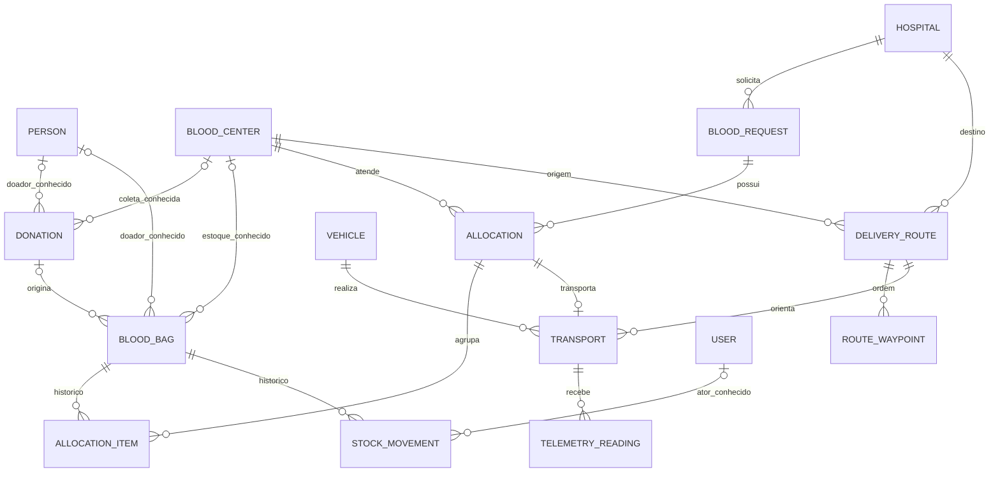

# Desenho do modelo de entidades base

## Decisões já confirmadas

A entrega cobre entidades, relacionamentos, migrações e testes do ciclo completo, com novos fluxos HTTP e algoritmos fora de escopo. Uma doação poderá gerar várias bolsas. Preservar os contratos atuais no cenário de uma bolsa, sem impor uma refatoração geral de pacotes.

Usar o pacote `com.hemovia.api.model`, repositórios Spring Data e nomes em inglês, conforme o projeto. Reutilizar `Person` como doador sintético e `User` como identidade de acesso; não criar `Donor` duplicando `Person`. Reutilizar `Hospital`; criar `BloodRequest` para evitar colisão com o registro didático `structures.basic.HospitalRequest`.

## Catálogo e responsabilidade

| Entidade | Campos e responsabilidade principais | Integridade esperada |
|---|---|---|
| User (existente) | Identidade do operador, nome, e-mail/CPF únicos e senha codificada | Preservar autenticação atual; sem fundir usuários e doadores ou expor senha nos DTOs |
| Person (existente) | Doador sintético, nome e contatos | Várias doações/bolsas podem apontar para a mesma pessoa |
| Hospital (existente) | Nome, cidade, latitude, longitude, prioridade 1–5 | Rejeição explícita de valores inválidos, sem ignorar setters |
| BloodCenter (nova) | UUID, nome, cidade, latitude e longitude | Origem estruturada de estoque, coleta e logística |
| Vehicle (nova) | UUID, código operacional único, identificação e capacidade em bolsas | Código não vazio/duplicado e capacidade positiva; sem cadastrar motorista sem requisito |
| Donation (existente) | UUID, data civil, texto collectionCenter legado, vínculo opcional ao hemocentro e doador, coleção de bolsas | Doação 1:N bolsas, sem cascade REMOVE para bolsas ou pessoa |
| BloodBag (existente) | UUID, ABO, Rh, componente, coleta/validade, estado, volume opcional em mL, doador/hemocentro/doação quando conhecidos, versão | Bolsa pertence a no máximo uma doação; sem exclusividade de pessoa; datas/volume coerentes |
| BloodRequest (nova) | Hospital, ABO/Rh, componente, quantidade inteira de bolsas, estado, createdAt/updatedAt e versão | PENDING inicial; quantidade positiva e hospital existente |
| Allocation (nova) | Requisição, centro de atendimento, estado, instantes e versão | Agrupa itens reservados e mantém tentativas/histórico |
| AllocationItem (nova) | Alocação, bolsa, estado de reserva e instantes de criação/liberação | Apenas uma reserva ativa por bolsa; referência histórica não é sobrescrita |
| DeliveryRoute (nova) | Hemocentro de origem, hospital de destino, distância em km, duração estimada em s, coleção ordenada de pontos | Medidas não negativas, coordenadas válidas, posição única por rota |
| Transport (nova) | Alocação, rota, veículo, estado, startedAt/completedAt e versão | Uma execução de transporte por alocação nesta versão; fim não precede início |
| TelemetryReading (nova) | Transporte, identificador do sensor, measuredAt/receivedAt e temperatura em Celsius | Leitura deve ter transporte e valores representáveis; sem impor limite térmico clínico |
| StockMovement (nova) | Bolsa, estado anterior/novo, tipo de movimento, instante, ator User e motivo quando informado | Registro histórico; sem cascade REMOVE a partir do cadastro ou bolsa |

São 14 entidades: cinco existentes e nove novas. `RouteWaypoint` é um `@Embeddable`, persistido em uma coleção ordenada com posição única; não exige identidade independente. As bolsas do transporte são obtidas pela alocação, evitando uma segunda lista conflitante. Indicadores estatísticos são derivados de requisições, movimentos e transportes; não criar entidades de relatório, algoritmo, fila ou pilha para duplicar dados operacionais.

## Relacionamentos

Os círculos em doação/bolsa representam compatibilidade com registros legados sem origem completa; não são autorização para preencher vínculos com IDs fictícios. Em cadastros completos fornecidos por novos consumidores, validar todos os vínculos informados e a consistência entre bolsa, doador e doação. Se o mesmo vínculo estiver informado em dois lugares, rejeitar divergência. Essa política ainda depende de confirmação do usuário (ASM-004/Q-003).

## Tipos e invariantes

- UUID para identidades, enums gravados como STRING e nomes de colunas explícitos para o esquema existente.
- `BloodType` mantém A/B/AB/O. `RhFactor` usa POSITIVE/NEGATIVE; `BloodComponent` contempla WHOLE_BLOOD, RED_BLOOD_CELLS, PLASMA, PLATELETS e CRYOPRECIPITATE. Preservar valores já usados pelos testes; documentar aliases de entrada e preflight para valores legados desconhecidos, sem conversão implícita por ordinal.
- Manter os estados atuais de `BloodBagStatus`. `RequestStatus`: PENDING, ALLOCATED, IN_TRANSIT, DELIVERED, CANCELLED. `AllocationStatus`: ALLOCATED, IN_TRANSIT, DELIVERED, CANCELLED. `ReservationStatus`: RESERVED, IN_TRANSIT, DELIVERED, RELEASED. `TransportStatus`: PLANNED, IN_TRANSIT, DELIVERED, CANCELLED. `MovementType`: ENTRY, RESERVATION, RELEASE, DISPATCH, DELIVERY, DISCARD.
- Datas civis são `LocalDate`; instantes operacionais são `Instant`/PostgreSQL timestamptz. Volume e medidas possuem unidade documentada; usar tipos decimais apropriados, sem valores NaN/Infinity. Nenhuma regra clínica é deduzida desses exemplos.
- Coleções inicializadas, associações LAZY e serialização somente por DTOs; evitar equals/hashCode/toString que percorram associações ou recursões. O construtor sem argumentos exigido pelo JPA não dispensa validação antes de persistir.
- Validar com Bean Validation, invariantes de associação e CHECK/FK/UNIQUE no PostgreSQL conforme o tipo de restrição. Acrescentar `@Version` aos agregados mutáveis para detectar atualização obsoleta; isso não substitui o índice contra reserva duplicada.
- Índice único parcial em AllocationItem por blood_bag_id para estados RESERVED/IN_TRANSIT. Associação RELEASED não impede outra alocação; UNIQUE(allocation_id, blood_bag_id) impede duplicação dentro da mesma alocação. Provar concorrência com duas transações reais e rollback da perdedora.
- Não criar cascade ALL/REMOVE entre agregados históricos. Preferir impedir exclusão referenciada; orphanRemoval não deve apagar o histórico ao remover um item de uma coleção Java.

As regras de selecionar bolsas, cancelar alocações, despachar e entregar todos os agregados de forma atômica serão implementadas em features próprias. Aqui se provam os registros e as restrições que esses serviços usarão; não apresentar um conjunto de enums como implementação dos fluxos completos.

## Evolução de Donation e compatibilidade

O lado proprietário do novo vínculo será `BloodBag.donation` com `donation_id`; `Donation.bloodBags` será a coleção inversa. Migrar o antigo `donations.blood_bag_id` somente após detectar referências repetidas/conflitantes. Verificar o backfill antes de remover a coluna antiga; nunca escolher uma doação arbitrariamente para uma bolsa vinculada a mais de uma.

O POST atual de doação continuará capaz de criar ou associar uma única bolsa. Adaptar os serviços/DTOs na mesma tarefa que altera a entidade, preservando compilação e testes existentes. O campo legado collectionCenter textual continua utilizável; bloodCenterId e donorId são acréscimos opcionais nos contratos antigos, com FK e validação quando enviados. Corrigir o descarte de donorId em BloodBagService, resolvendo Person via repositório.

Na resposta, `bloodBags` lista todas as bolsas. `bloodBag` preserva o formato para exatamente uma bolsa e fica nulo quando houver zero ou várias; documentar sua depreciação. O modelo não expõe a coleção JPA diretamente. Datas nos contratos são datas ISO de calendário; testar a adaptação do legado Date em pelo menos UTC e America/Sao_Paulo, sem deslocar o dia.

Migrar `BloodBag.donor` de OneToOne para ManyToOne. Não apagar doadores ao remover bolsa/doação. Preservar User, suas credenciais e IDs sem reclassificar usuários como doadores.

## Migrações e ambiente de teste

Criar novas versões após V3, por responsabilidade: V4 normalização/cadastros/doações, V5 requisições/alocações, V6 rotas/transporte/telemetria e V7 movimentos de estoque. Arquivos V1–V3 permanecem byte a byte intactos. O esquema final é validado pelo Hibernate contra PostgreSQL real, com cenário de instalação vazia e cenário de upgrade com massa sintética legada.

O preflight deve identificar códigos não mapeáveis, vínculos conflitantes e dados que violariam CHECK/FK/UNIQUE. A migração falha com erro rastreável e transação revertida; não apagar registros ou criar um hemocentro/doador genérico para fazê-la passar. Colunas novas desconhecidas podem continuar nulas conforme a política de compatibilidade proposta.

Usar PostgreSQL descartável, via container ou instância de teste dedicada/efêmera, configurada por perfil de teste. Não ler o .env pessoal, apontar para banco de uso corrente, alterar credenciais reais ou usar H2 para provar índices parciais/concorrência PostgreSQL. A execução pode precisar de ferramentas/dependências adicionais: identificar o impedimento e obter a permissão técnica necessária, sem skip nem sucesso simulado.

## Prova por critério e rastreabilidade

Os testes Java usam `@DisplayName` com os códigos de aceite e casos positivos/negativos. O comando de verificação executa a suíte Maven completa, incluindo contextLoads, em perfil isolado. Um adaptador Node em `scripts/spec-java/` transforma os resultados por caso Surefire em testes TAP consumíveis pelo motor existente; o manifesto relaciona cada critério aos identificadores reais de classe/método. O adaptador não pode conceder PASS pelo exit code global do Maven nem pela existência de XML.

Exigir XML recente da execução identificada, rejeitar casos ausentes/ignorados, agregar falhas de todos os casos de um critério e propagar falha global de outras suítes. Evitar consumir relatórios antigos já presentes em api/target. Testar o adaptador contra relatório antigo, caso ausente, falha e skip; uma execução Maven por verificação, sem múltiplos builds concorrentes disparados por cada teste Node.

Expandir testGlobs para os testes Java. O srcGlobs passa a incluir explicitamente as fontes desta entrega listadas nas tarefas, além do que já era observado, com o alcance documentado. Não anunciar rastreabilidade de todo o código legado, nem excluir arquivos da feature para esconder órfãos. Arquivos que só forem verificados por regressão devem ser identificados como legado, sem atribuir a esta feature sua criação.

Baseline de 22/10/2026: `node --test` executa quatro testes documentais da revisão, com um PASS e três FAIL porque validam referências do snapshot antigo contra o checkout atual (incluindo a migration renomeada). Corrigir essas consultas para ler `git show 91d1f981e8860df0cb53fa9472edd8f1bcd91e89:caminho` quando a evidência se refere ao snapshot. Preservar validações de conteúdo/linha; não simplesmente aceitar arquivo ausente ou atualizar a revisão histórica para afirmar um estado que ela não analisou. Links dos próprios relatórios continuam sendo conferidos no checkout atual.

| Critério | Prova funcional prevista |
|---|---|
| AC-005 | ReferenceEntitiesTest e persistência de doador repetido/veículo duplicado |
| AC-006 | OrganizationValidationTest, coordenadas zero/ausentes/fora do intervalo |
| AC-007 | DonationBloodBagPersistenceTest, duas bolsas e vínculo conflitante |
| AC-008 | BloodBagDomainTest e constraints de tipos/datas/volume |
| AC-009 | BloodRequestPersistenceTest com quantidade válida/inválida e FK |
| AC-010 | AllocationConcurrencyTest com transações independentes, liberação e versão obsoleta |
| AC-011 | DeliveryRoutePersistenceTest com ordem, posição única e medidas inválidas |
| AC-012 | TransportTelemetryPersistenceTest com referências, instantes e histórico |
| AC-013 | BaseEntitiesMigrationTest para banco novo, legado e preflight rejeitado |
| AC-014 | Adaptador testado e suíte completa sem skips, com PostgreSQL isolado |
| AC-015 | ExistingContractsRegressionTest e testes existentes de autenticação/bolsas |

## Ordem e execução recomendadas

Recomendação: oito tarefas em sequência (T-005 a T-012), pois os tipos comuns, adaptações de contratos e migrações se encadeiam. Há potencial de separar doações/requisições/rotas após T-006, mas o gerador não representa dependências entre ondas; não lançar essas tarefas antes dos pré-requisitos só porque seus arquivos são disjuntos. Se o usuário escolher paralelismo, preparar os pré-requisitos primeiro, regenerar o plano do trabalho restante e confirmar a integração na ordem necessária.

Modelo/esforço propostos para todas as tarefas: gpt-5.6-terra / medium, mantendo a configuração utilizada na revisão, sujeitos à confirmação para esta execução. Usar a rota manual de sessões headless com commits controlados pelo orquestrador: o executor automático anterior tratou commit bloqueado como sucesso e removeu trabalho não commitado. O script gerado fica como artefato do plano; não executá-lo sem resolver essa condição. Não mudar sandbox para danger-full-access.
