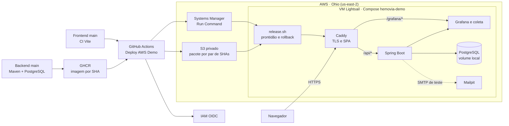

# Deploy atual da demonstração

A publicação manual empacota o build Vite, a imagem da API e os arquivos de runtime. O script usa bloqueio para serializar deploy e rollback, valida a prontidão e conserva a versão anterior. O projeto Compose preserva os volumes. O rollback reverte a aplicação. Alterações de schema têm ciclo próprio.

| Checagem em 26/11/2026 | Evidência |
| --- | --- |
| CI backend main 95bc497 | [GitHub Actions · sucesso](https://github.com/HemovIA/hemovia-backend/actions/runs/45883071364) |
| CI frontend main 914e398 | [GitHub Actions · sucesso](https://github.com/HemovIA/hemovia-frontend/actions/runs/45880544591) |
| Publicação de versão | [GitHub Actions · sucesso](https://github.com/HemovIA/hemovia-backend/actions/runs/45883467828) |
| Rollback da aplicação | [GitHub Actions · sucesso](https://github.com/HemovIA/hemovia-backend/actions/runs/45883714627) |
| SPA pública | [HTTP 200 via HTTPS](https://18.216.26.95/) |
| API sem sessão | [HTTP 401 via HTTPS](https://18.216.26.95/api/v1/requests) |
| Grafana | [HTTP 200 após redirecionamento ao login](https://18.216.26.95/grafana/) |

[Workflow publicado](https://github.com/HemovIA/hemovia-backend/blob/95bc4978c7fcd76c357c2e21dd8385317114df04/.github/workflows/deploy-aws-demo.yml) · [Script publicado](https://github.com/HemovIA/hemovia-backend/blob/95bc4978c7fcd76c357c2e21dd8385317114df04/deploy/lightsail/release.sh)
