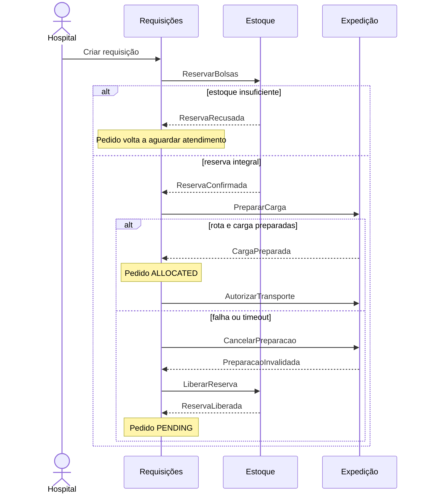

# Saga de atendimento

Projeção em que Requisições orquestra o atendimento. Os comandos e eventos atravessam a fila e carregam ID de saga, tentativa e mensagem.

Expedição invalida a tentativa de forma idempotente mesmo se o comando de cancelamento chegar antes do de preparação. O transporte permanece bloqueado até autorização. Se a compensação falhar, Requisições conserva o estado pendente de compensação e permite retomada após investigação.
